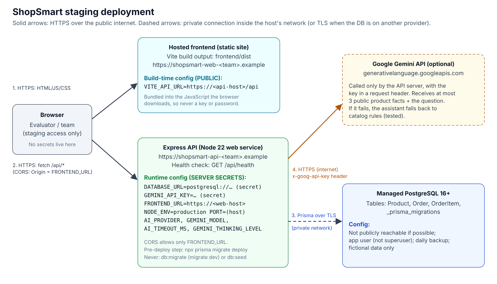

# ShopSmart Deployment Plan (private staging)

Status: **plan only.** No hosting or database has been approved for this team yet, so the release is a **local release candidate**. Replace every `<placeholder>` with the approved platform's real values, and check each hosting command against that platform's current documentation before use.

Source: [`deployment-diagram.svg`](deployment-diagram.svg)

## 1. Services and the four connection paths

| # | From → To | Crosses the internet? | Protocol | What travels |
| --- | --- | --- | --- | --- |
| 1 | Browser → hosted frontend | Yes | HTTPS | `index.html`, JS and CSS from `frontend/dist` |
| 2 | Browser → Express API | Yes | HTTPS + CORS | `GET /api/products`, `POST /api/orders`, `POST /api/assistant/questions`, `GET /api/health` |
| 3 | Express API → PostgreSQL | No if both are on the same host's private network; otherwise yes, over TLS | PostgreSQL wire protocol via Prisma | Product, Order and OrderItem rows |
| 4 | Express API → Google Gemini (optional) | Yes | HTTPS, key in the `x-goog-api-key` header | Question and at most 3 public product facts. No customer data. |

The browser never talks to PostgreSQL or Gemini directly.

## 2. Configuration by service

| Service | Variable | Value (staging) | Public or secret | Where it is set |
| --- | --- | --- | --- | --- |
| Frontend | `VITE_API_URL` | `https://<api-host>/api` | **Public.** Vite inlines `VITE_` variables into the browser bundle. | Static-site build settings (build-time) |
| API | `DATABASE_URL` | `postgresql://<app_user>:<password>@<db-host>:5432/<db>?schema=public&sslmode=require` | **Secret** | API service environment / secret store |
| API | `GEMINI_API_KEY` | key from Google AI Studio (optional) | **Secret** | API service environment / secret store |
| API | `FRONTEND_URL` | `https://<web-host>`: exact origin, no trailing slash, no path | Public | API service environment |
| API | `NODE_ENV` | `production` | Public | API service environment |
| API | `PORT` | provided by the host | Public | Host injects it; `server.js` reads `process.env.PORT` |
| API | `AI_PROVIDER`, `GEMINI_MODEL`, `AI_TIMEOUT_MS`, `GEMINI_THINKING_LEVEL` | `gemini`, `gemini-3.8-flash`, `25000`, `low` (or `AI_PROVIDER=rules` to disable AI) | Public | API service environment |
| Database | admin password | set by provider | **Secret** | Provider dashboard only; never in the repo |

## 3. Answers to the challenge questions

**Where will the Vite build files be hosted? Which URL will the frontend use for the API?**
On the approved static host (for example a Netlify, Vercel, Render Static Site or Cloudflare Pages project, depending on what the class approves), at `https://<web-host>`. Build settings:
- root `frontend` (or repo root with `npm ci && npm run build`)
- publish directory `frontend/dist`
- environment `VITE_API_URL=https://<api-host>/api`

Because the value is baked in at build time, the frontend must be **rebuilt** whenever the API URL changes. The app uses client-side routes (`/cart`, `/checkout`, `/products/:id`), so the host also needs a single-page-app rewrite: every unknown path serves `/index.html`. Otherwise refreshing `/cart` returns the host's own 404.

**Where will the Express server run, and what public URL will serve `/api/health`?**
On a Node 22 web service at `https://<api-host>`. Health is at `https://<api-host>/api/health`.
- Build command: `npm ci && npm run db:generate`
- Pre-deploy (release) command: `npx prisma migrate deploy --schema backend/prisma/schema.prisma`
- Start command: `npm run start --workspace backend`
- Health-check path: `/api/health`

After this release, `/api/health` returns `200 {"status":"ok"}` only when PostgreSQL answers. Otherwise it returns `503 {"status":"error","database":"unreachable"}` (DEF-2), so the platform's health check really verifies the database path.

**Where will PostgreSQL run, and how will the server receive `DATABASE_URL` securely?**
On a managed PostgreSQL 16+ instance from the approved provider, ideally in the same region and private network as the API. `DATABASE_URL` is entered once in the API service's secret environment settings. It is never committed, never given a `VITE_` prefix, and never pasted into chat, screenshots or tickets. Use a dedicated application user that owns the `shopsmart` database rather than the provider's superuser, and `sslmode=require` when the connection leaves a private network.

**Which origin will be permitted by `FRONTEND_URL` and the API CORS configuration?**
Exactly one: `https://<web-host>` (the staging frontend origin). `app.js` passes this single string to `cors({ origin })`, so it must match the browser's origin character for character: scheme, host, and no trailing slash. Any other origin receives no `Access-Control-Allow-Origin` match. Tested locally: a request with `Origin: https://evil.example` received `Access-Control-Allow-Origin: http://localhost:5173`, which the browser rejects.

**Where will a provider key be stored, if present? How will it be kept out of the frontend bundle and repository?**
Only in the API service's secret environment variables (`GEMINI_API_KEY`). It is kept out by four guards:
1. It has no `VITE_` prefix, so Vite cannot inline it.
2. Only backend code (`aiProvider.js`) reads it, sending it in a request header and redacting it from logs.
3. `.gitignore` excludes `.env`, and only `.env.example` (empty key) is committed.
4. Before each release, the built bundle is scanned for key patterns. See `RELEASE_TEST_RECORD.md` §6: no matches.

If the key is ever exposed, revoke it in Google AI Studio and issue a new one.

**How will database migrations be applied before first use, without wiping existing orders?**
With Prisma's production workflow: `npx prisma migrate deploy`. It applies only committed migrations from `backend/prisma/migrations/` that are not yet recorded in `_prisma_migrations`. It never resets data and never generates new migrations. It runs as the pre-deploy step on every release.
- **Never** run `npm run db:migrate` against staging. It runs `prisma migrate dev`, which is for local development and may prompt to reset the database.
- **Never** run `npm run db:seed` against a database with orders you need: `seed.js` deletes all OrderItem, Order and Product rows first.
- **First use only:** on a brand-new, empty staging database, run `migrate deploy`, then seed once (`DATABASE_URL=<staging> npm run db:seed` from a trusted machine) **before** any orders exist. Record the date.
- Take a provider backup/snapshot before any migration on a database that already holds orders.

**Who can access the staging app, and will only fictional customer data be used?**
Access is limited to the team and the instructor:
- use the host's password protection or private-preview feature if available
- otherwise use an unlisted URL shared only with the instructor, and keep the database not publicly reachable
- no public link is posted

Only test data is used: team members' names (Daniel Jehd, Kian Robe, James Mercado, Igor Toledano) or placeholder names, test emails and sample addresses, never real customers. The checkout has no authentication, no privacy notice and no data-retention controls, so it **must not** be opened to real customers or collect real personal data.

## 4. Deployment checklist (when hosting is approved)

1. Create the PostgreSQL instance and app user. Store `DATABASE_URL` as an API secret.
2. Create the API service with Node 22 and the build, pre-deploy and start commands above. Set `FRONTEND_URL`, `NODE_ENV=production` and the optional AI variables.
3. Deploy the API. Confirm `https://<api-host>/api/health` returns `200 {"status":"ok"}`.
4. First deploy only: seed the empty database once. Confirm `GET /api/products` returns 6 products.
5. Create the static site with `VITE_API_URL=https://<api-host>/api` and the SPA rewrite. Deploy.
6. Open `https://<web-host>`. In DevTools → Network, confirm requests go to `<api-host>` and no CORS errors appear.
7. Run the staging smoke test (§5) and record the date, URLs and results in the release note.

## 5. Staging smoke test (same as the local one)

| Step | Pass condition |
| --- | --- |
| Health | `GET https://<api-host>/api/health` returns 200 `{"status":"ok"}` |
| Products | Home page shows the catalog; searching `keyboard` returns Compact Mechanical Keyboard |
| Cart | Add 2 items, change a quantity, remove one; totals match price × quantity |
| Checkout | Fictional details create one order and show its number; invalid email is refused |
| Assistant | "Which keyboard is below ₱2,000?" links Product #2. "Do you sell running shoes?" gives an honest no-match. |
| Data kept | Order count after the test = before + orders placed (no reseed) |
| Secrets | DevTools → Sources: bundle contains the API URL only; no key or `DATABASE_URL` |

## 6. Known deployment risks

- **Rate limiter behind a proxy.** Hosted platforms put a reverse proxy in front of Express. Express is not configured with `trust proxy`, so `express-rate-limit` sees the proxy's IP for every visitor. The assistant's 20-per-minute limit then becomes shared across all users, and the limiter may log an `X-Forwarded-For` validation warning. Before a public launch, set `app.set('trust proxy', 1)` (one proxy hop) after confirming the platform's proxy depth. Not changed in this release because it doesn't break a required journey.
- **Cold starts.** Free-tier API services may sleep. The frontend now times out after 15 s with a clear message (DEF-1) instead of loading forever, but the first request after sleep may need a retry.
- **Dev-tool advisories.** `npm audit` still reports advisories in the Prisma CLI (`deepmerge-ts`) and Vitest. They are build/test tools, not runtime dependencies of the Express server, and need major upgrades (Prisma 7, Vitest 4).

## References

- Prisma 6 development vs production migrations: <https://docs.prisma.io/docs/orm/v6/prisma-migrate/workflows/development-and-production>
- Vite environment variables (`VITE_` values are public): <https://vite.dev/guide/env-and-mode>
